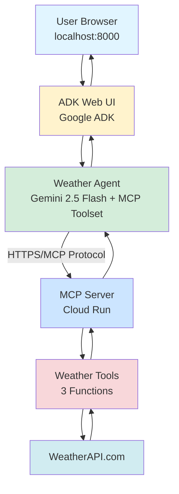

# AI Weather Agent with Google ADK + Remote MCP on Cloud Run ⚡🌤️

A production-ready **AI agent** built with **Google Agent Development Kit (ADK)** that connects to **remote MCP tools deployed on Google Cloud Run**. This demonstrates modern AI agent architecture with remote tool execution over the internet.

## 🚀 What You Built

This system consists of two main components:
- **🤖 ADK Agent**: AI agent built with Google ADK, featuring a web UI and connecting to remote MCP server
- **🌐 MCP Server**: FastMCP weather server with custom HTTP endpoints deployed on Google Cloud Run

## ✨ Features

### 🔥 **Google ADK Integration**
- Professional web UI at localhost:8000
- Real-time streaming responses
- Agent built with Google Agent Development Kit
- Gemini 2.5 Flash for intelligent reasoning
- Remote MCP tool execution over HTTPS

### 🌤️ **Weather Capabilities**
- Real-time weather data for any city worldwide
- Multi-day weather forecasts
- Australian cities optimized
- Health check endpoint for monitoring

### ☁️ **Production Ready**
- Google Cloud Run deployment
- Secure secret management
- Auto-scaling and high availability
- HTTPS with custom domains

## 🎯 Live Demo

Your deployed weather server is running at:
```
https://weather-mcp-server-583791017886.asia-southeast1.run.app
```

## 🛠️ Available Tools

| Tool | Description | Parameters |
|------|-------------|------------|
| `get_current_weather` | Real-time weather conditions | `city: string` |
| `get_forecast` | Multi-day weather forecast | `city: string, days: int (1-10)` |
| `health_check` | Server health verification | None |

## 🚀 Quick Start

### Prerequisites

1. **Google API Key**: Get from [Google AI Studio](https://aistudio.google.com/apikey)
2. **Python 3.12+**: Required for both agent and server
3. **uv**: Python package manager (`pip install uv`)

### Run the ADK Agent

```bash
# Set up environment
cd mcp-client
echo "GOOGLE_API_KEY=your_gemini_api_key_here" > .env

# Install dependencies
uv sync

# Start the ADK web interface
uv run adk web

# Or use the quick start script
./start_agent.sh
```

### Open the Web Interface

1. Navigate to `http://localhost:8000` in your browser
2. Select `weather_agent` from the dropdown
3. Start chatting!

### Example Queries

```
What's the weather in Brisbane?
Give me a 3-day forecast for Tokyo
Compare weather between Sydney and Melbourne
Will I need an umbrella in London tomorrow?
```

## 🏗️ Architecture



**Key Components:**
- **Browser UI**: ADK Web interface at localhost:8000
- **Google ADK**: Agent framework with web UI and streaming
- **MCP Toolset**: Connects to remote MCP server via HTTP
- **Cloud Run**: Serverless deployment, auto-scaling
- **Custom HTTP Endpoints**: MCP protocol over HTTPS

## 📦 Project Structure

```
mcp-on-cloudrun/
├── mcp-client/                    # ADK Agent
│   ├── weather_agent/            # Agent package (discovered by ADK)
│   │   ├── agent.py             # Main agent with remote MCP connection
│   │   └── __init__.py          # Package exports
│   ├── start_agent.sh           # Quick start script
│   ├── verify_setup.py          # Setup verification
│   ├── pyproject.toml           # Dependencies (google-adk, etc.)
│   ├── .env                     # Environment variables (create this!)
│   └── README.md                # Client documentation
│
├── mcp-server/                   # Weather MCP Server
│   ├── weather.py               # FastMCP server + custom HTTP endpoints
│   ├── Dockerfile               # Container configuration
│   ├── deploy.sh                # Cloud Run deployment script
│   └── pyproject.toml           # Server dependencies (fastmcp, starlette)
│
├── README.md                     # This file
├── SETUP_GUIDE.md               # Complete setup instructions
├── SUCCESS.md                   # Success documentation
└── presentation.md              # Presentation outline
```

## 🔧 Local Development

### Server Development (Local Testing)

```bash
cd mcp-server
export WEATHERAPI_KEY="your_weatherapi_key"
uv run python weather.py

# Server will start on http://localhost:8080
# You can test MCP endpoints directly
```

### Agent Development (ADK)

```bash
cd mcp-client

# Create .env file
echo "GOOGLE_API_KEY=your_gemini_api_key" > .env

# Install dependencies
uv sync

# Start ADK web interface
uv run adk web

# Agent will be available at http://localhost:8000
```

## ☁️ Cloud Deployment

### Automated Deployment

```bash
cd mcp-server
export GCLOUD_PROJECT_ID="your-project-id"
export WEATHERAPI_KEY="your_weatherapi_key"
export GCLOUD_REGION="asia-southeast1"
./deploy.sh
```

### Manual Deployment

```bash
# Enable required services
gcloud services enable \
    cloudbuild.googleapis.com \
    run.googleapis.com \
    secretmanager.googleapis.com

# Create secret for WeatherAPI key
echo -n "$WEATHERAPI_KEY" | gcloud secrets create weatherapi-key --data-file=-

# Deploy to Cloud Run
gcloud run deploy weather-mcp-server \
    --source . \
    --platform managed \
    --region asia-southeast1 \
    --allow-unauthenticated \
    --set-secrets WEATHERAPI_KEY=weatherapi-key:latest \
    --port 8080 \
    --memory 512Mi \
    --timeout 300
```

### Update Deployment

```bash
cd mcp-server
gcloud run deploy weather-mcp-server \
    --source . \
    --platform managed \
    --region asia-southeast1 \
    --allow-unauthenticated \
    --port 8080 \
    --clear-base-image
```

## ⚙️ Configuration

### Environment Variables

#### Client Configuration
- `GOOGLE_API_KEY`: **Required** - Your Google AI API key

#### Server Configuration  
- `WEATHERAPI_KEY`: **Required** - WeatherAPI.com API key
- `PORT`: Optional - Server port (default: 8080)

#### Deployment Configuration
- `GCLOUD_PROJECT_ID`: Your Google Cloud project ID
- `GCLOUD_REGION`: Deployment region (default: asia-southeast1)

### Secret Management

```bash
# Update WeatherAPI key
echo -n "new_api_key" | gcloud secrets versions add weatherapi-key --data-file=-

# View secret information
gcloud secrets describe weatherapi-key

# List versions
gcloud secrets versions list weatherapi-key
```

## Usage Examples

### Natural Language Queries
```
✅ "What's the weather like in Brisbane right now?"
✅ "Give me a 3-day forecast for Sydney"  
✅ "Is it going to rain in Melbourne tomorrow?"
✅ "Compare temperatures between Perth and Adelaide"
✅ "What's the UV index in Darwin?"
```

### International Cities
```
✅ "Current weather in London"
✅ "Tokyo weather forecast for the week"
✅ "What's the temperature in New York?"
✅ "Will it snow in Moscow this week?"
```

## 🔍 How It Works

1. **User Input**: You type a natural language weather query in the ADK web interface
2. **ADK Agent**: Routes query to Gemini 2.5 Flash via Google ADK
3. **AI Processing**: Gemini understands your intent and available MCP tools
4. **Tool Selection**: Gemini chooses the right weather tool (get_current_weather or get_forecast)
5. **Parameter Extraction**: City names and options are automatically extracted
6. **Remote MCP Call**: ADK agent makes HTTPS call to Cloud Run MCP server
7. **Tool Execution**: MCP server executes the tool and calls WeatherAPI.com
8. **Response Flow**: Weather data flows back through MCP protocol to ADK agent
9. **AI Formatting**: Gemini formats response in natural language
10. **Streaming Display**: Response streams back to your browser in real-time

## 📊 API Limits & Costs

### WeatherAPI.com (Free Tier)
- ✅ 1 million calls/month
- ✅ Real-time weather data
- ✅ 10-day forecasts
- ✅ No credit card required

### Google Gemini API
- ✅ Generous free tier
- ✅ Pay-per-use pricing
- ✅ Function calling included

### Google Cloud Run
- ✅ 2 million requests/month free
- ✅ Pay only for usage
- ✅ Auto-scaling included

## 🛡️ Security Features

- 🔐 **Secret Manager**: API keys stored securely in Google Cloud
- 🛡️ **IAM Controls**: Fine-grained access permissions
- 🔄 **Key Rotation**: Seamless API key updates
- 🌐 **HTTPS Only**: End-to-end encryption
- 🚫 **No Exposed Keys**: No credentials in code or logs

## Testing

### Test Server Health
```bash
curl https://weather-mcp-server-583791017886.asia-southeast1.run.app/mcp \
  -H "Accept: text/event-stream"
```

### Test MCP Connection
```bash
cd mcp-client
GOOGLE_API_KEY=test uv run python -c "
import asyncio
from client import MCPClient
async def test():
    client = MCPClient()
    await client.connect_to_server('https://weather-mcp-server-583791017886.asia-southeast1.run.app')
    tools = await client._list_tools()
    print('Tools:', [t.name for t in tools])
asyncio.run(test())
"
```

## 📄 License

MIT License - see [LICENSE](LICENSE) file for details.

## Acknowledgments

- **Google Gemini**: For powerful AI capabilities
- **WeatherAPI.com**: For reliable weather data
- **MCP Protocol**: For standardized AI tool integration
- **FastMCP**: For simplified server development
- **Google Cloud**: For scalable infrastructure

---

**Built with ❤️ using Gemini 2.5 Flash, MCP Protocol, and Google Cloud**
