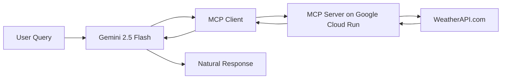

# Gemini MCP Weather System ⚡🌤️

A complete **Model Context Protocol (MCP)** system featuring a **Gemini 2.5 Flash** client and weather server deployed on **Google Cloud Run**. This demonstrates modern AI tool calling with real-time weather data integration.

## 🚀 What You Built

This system consists of two main components:
- **🤖 MCP Client**: Gemini 2.5 Flash powered client with tool calling capabilities
- **🌐 MCP Server**: FastMCP weather server deployed on Google Cloud Run

## ✨ Features

### 🔥 **Gemini 2.5 Flash Integration**
- Intelligent natural language queries
- Automatic tool selection and parameter extraction
- Function calling with MCP protocol
- Hybrid connection support (local + remote servers)

### 🌤️ **Weather Capabilities**
- Real-time weather data for any city worldwide
- Multi-day weather forecasts
- Australian cities optimized
- Health check endpoint for monitoring

### ☁️ **Production Ready**
- Google Cloud Run deployment
- Secure secret management
- Auto-scaling and high availability
- HTTPS with custom domains

## 🎯 Live Demo

Your deployed weather server is running at:
```
https://weather-mcp-server-583791017886.asia-southeast1.run.app
```

## 🛠️ Available Tools

| Tool | Description | Parameters |
|------|-------------|------------|
| `get_current_weather` | Real-time weather conditions | `city: string` |
| `get_forecast` | Multi-day weather forecast | `city: string, days: int (1-10)` |
| `health_check` | Server health verification | None |

## 🚀 Quick Start

### Prerequisites

1. **Google API Key**: Get from [Google AI Studio](https://makersuite.google.com/app/apikey)
2. **Python 3.12+**: Required for both client and server
3. **uv**: Python package manager (`pip install uv`)

### Run the Client

```bash
# Connect to your deployed Cloud Run server
cd mcp-client
export GOOGLE_API_KEY="your_gemini_api_key_here"
uv run python client.py https://weather-mcp-server-583791017886.asia-southeast1.run.app
```

### Example Queries

```
Query: What's the weather in Brisbane?
Query: Give me a 5-day forecast for Canberra
Query: Compare weather between Sydney and Melbourne
Query: Is it going to rain in Brisbane tomorrow?
```

## 🏗️ Architecture



## 📦 Project Structure

```
mcp-on-cloudrun/
├── mcp-client/              # Gemini MCP Client
│   ├── client.py           # Main client application
│   ├── pyproject.toml      # Client dependencies
│   └── README.md           # Client documentation
├── mcp-server/             # Weather MCP Server
│   ├── weather.py          # FastMCP server
│   ├── app.py             # ASGI app wrapper
│   ├── Dockerfile         # Container configuration
│   ├── deploy.sh          # Deployment script
│   └── pyproject.toml     # Server dependencies
└── README.md              # This file
```

## 🔧 Local Development

### Server Development

```bash
cd mcp-server
export WEATHERAPI_KEY="your_weatherapi_key"
uv run python weather.py
```

### Client Development (Local Server)

```bash
cd mcp-client
export GOOGLE_API_KEY="your_gemini_api_key"
uv run python client.py ../mcp-server/weather.py
```

## ☁️ Cloud Deployment

### Automated Deployment

```bash
cd mcp-server
export GCLOUD_PROJECT_ID="your-project-id"
export WEATHERAPI_KEY="your_weatherapi_key"
export GCLOUD_REGION="asia-southeast1"
./deploy.sh
```

### Manual Deployment

```bash
# Enable required services
gcloud services enable \
    cloudbuild.googleapis.com \
    run.googleapis.com \
    secretmanager.googleapis.com

# Create secret for WeatherAPI key
echo -n "$WEATHERAPI_KEY" | gcloud secrets create weatherapi-key --data-file=-

# Deploy to Cloud Run
gcloud run deploy weather-mcp-server \
    --source . \
    --platform managed \
    --region asia-southeast1 \
    --allow-unauthenticated \
    --set-secrets WEATHERAPI_KEY=weatherapi-key:latest \
    --port 8080 \
    --memory 512Mi \
    --timeout 300
```

### Update Deployment

```bash
cd mcp-server
gcloud run deploy weather-mcp-server \
    --source . \
    --platform managed \
    --region asia-southeast1 \
    --allow-unauthenticated \
    --port 8080 \
    --clear-base-image
```

## ⚙️ Configuration

### Environment Variables

#### Client Configuration
- `GOOGLE_API_KEY`: **Required** - Your Google AI API key

#### Server Configuration  
- `WEATHERAPI_KEY`: **Required** - WeatherAPI.com API key
- `PORT`: Optional - Server port (default: 8080)

#### Deployment Configuration
- `GCLOUD_PROJECT_ID`: Your Google Cloud project ID
- `GCLOUD_REGION`: Deployment region (default: asia-southeast1)

### Secret Management

```bash
# Update WeatherAPI key
echo -n "new_api_key" | gcloud secrets versions add weatherapi-key --data-file=-

# View secret information
gcloud secrets describe weatherapi-key

# List versions
gcloud secrets versions list weatherapi-key
```

## Usage Examples

### Natural Language Queries
```
✅ "What's the weather like in Brisbane right now?"
✅ "Give me a 3-day forecast for Sydney"  
✅ "Is it going to rain in Melbourne tomorrow?"
✅ "Compare temperatures between Perth and Adelaide"
✅ "What's the UV index in Darwin?"
```

### International Cities
```
✅ "Current weather in London"
✅ "Tokyo weather forecast for the week"
✅ "What's the temperature in New York?"
✅ "Will it snow in Moscow this week?"
```

## 🔍 How It Works

1. **User Input**: You type a natural language weather query
2. **AI Processing**: Gemini 2.5 Flash understands your intent
3. **Tool Selection**: AI chooses the right weather tool
4. **Parameter Extraction**: City names and options are extracted
5. **MCP Call**: Client makes tool call to Cloud Run server
6. **API Request**: Server fetches data from WeatherAPI.com
7. **Response**: Real-time weather data returned via MCP
8. **Natural Output**: Gemini formats response in natural language

## 📊 API Limits & Costs

### WeatherAPI.com (Free Tier)
- ✅ 1 million calls/month
- ✅ Real-time weather data
- ✅ 10-day forecasts
- ✅ No credit card required

### Google Gemini API
- ✅ Generous free tier
- ✅ Pay-per-use pricing
- ✅ Function calling included

### Google Cloud Run
- ✅ 2 million requests/month free
- ✅ Pay only for usage
- ✅ Auto-scaling included

## 🛡️ Security Features

- 🔐 **Secret Manager**: API keys stored securely in Google Cloud
- 🛡️ **IAM Controls**: Fine-grained access permissions
- 🔄 **Key Rotation**: Seamless API key updates
- 🌐 **HTTPS Only**: End-to-end encryption
- 🚫 **No Exposed Keys**: No credentials in code or logs

## Testing

### Test Server Health
```bash
curl https://weather-mcp-server-583791017886.asia-southeast1.run.app/mcp \
  -H "Accept: text/event-stream"
```

### Test MCP Connection
```bash
cd mcp-client
GOOGLE_API_KEY=test uv run python -c "
import asyncio
from client import MCPClient
async def test():
    client = MCPClient()
    await client.connect_to_server('https://weather-mcp-server-583791017886.asia-southeast1.run.app')
    tools = await client._list_tools()
    print('Tools:', [t.name for t in tools])
asyncio.run(test())
"
```

## 📄 License

MIT License - see [LICENSE](LICENSE) file for details.

## Acknowledgments

- **Google Gemini**: For powerful AI capabilities
- **WeatherAPI.com**: For reliable weather data
- **MCP Protocol**: For standardized AI tool integration
- **FastMCP**: For simplified server development
- **Google Cloud**: For scalable infrastructure

---

**Built with ❤️ using Gemini 2.5 Flash, MCP Protocol, and Google Cloud**
